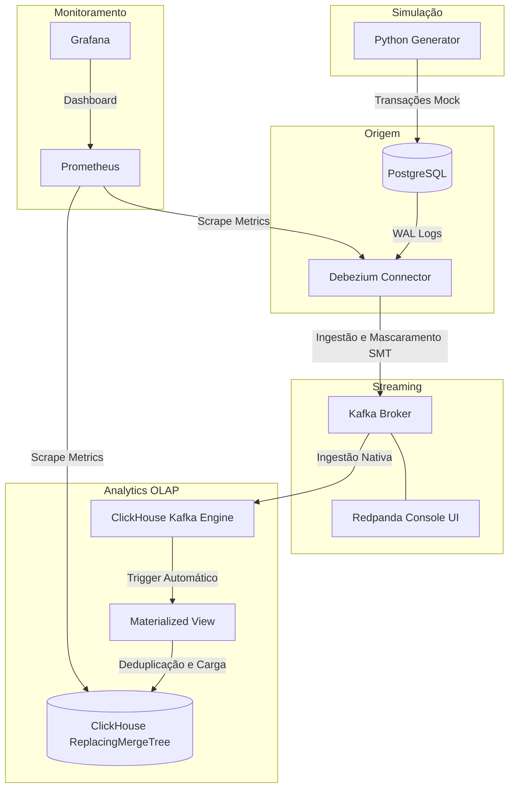

# Change Data Capture (CDC) & Real-Time Analytics Pipeline

Este projeto implementa uma pipeline de engenharia de dados **end-to-end** de nível sênior, utilizando **Change Data Capture (CDC)** para capturar mutações de banco de dados (INSERTS, UPDATES, DELETES) em tempo real a partir de um banco transacional PostgreSQL e propagá-las para um banco analítico colunar (ClickHouse) de forma segura e monitorada.

---

## 🏗️ Arquitetura da Solução



### Componentes & Justificativa de Design:
1. **PostgreSQL**: Banco transacional OLTP que simula o banco de produção de um e-commerce. Configurado com `wal_level = logical` e `REPLICA IDENTITY FULL` para habilitar CDC completo.
2. **Debezium (Kafka Connect)**: Escuta o log de transações do PostgreSQL (Write-Ahead Log - WAL) e gera eventos de mutação. Ele inclui uma **Single Message Transformation (SMT)** para mascarar e-mails de clientes na origem, atendendo às regulamentações da **LGPD/GDPR**.
3. **Apache Kafka & Redpanda Console**: Message broker gerenciando a persistência e tópicos. Redpanda Console expõe uma interface de depuração visual.
4. **ClickHouse OLAP**: Destino final analítico. Utiliza o motor **Kafka nativo do ClickHouse** integrado com **Materialized Views**. Tabelas finais utilizam **ReplacingMergeTree** para deduplicação assíncrona orientada pela timestamp de transação (`ts_ms`) e uma flag lógica de exclusão (`is_deleted`).
5. **Observabilidade (Prometheus & Grafana)**: Prometheus coleta métricas nativas do ClickHouse e do Kafka Connect. O Grafana serve como interface analítica de monitoramento do pipeline.
6. **Infraestrutura como Código (Terraform)**: Módulos de provisionamento para espelhar esta arquitetura na AWS em escala empresarial (VPC, RDS Postgres, MSK Kafka e ClickHouse no EC2).

---

## 📁 Estrutura de Diretórios

```text
cdc_pipeline/
│
├── docker-compose.yml          # Definição de todos os serviços (Postgres, Kafka, ClickHouse, Prometheus, Grafana)
├── setup.ps1                   # Automação do setup (Docker, healthcheck, auto-recuperação do conector)
├── README.md                   # Documentação do projeto (esta página)
│
├── debezium/
│   └── register_connector.json # Configuração do conector Debezium com mascaramento SMT
│
├── sql/
│   ├── init_postgres.sql       # Tabelas originais, dados mock e replicação lógica
│   └── init_clickhouse.sql     # Tabelas OLAP, Tabelas do motor Kafka e Views
│
├── monitoring/
│   ├── prometheus.yml          # Configuração de scraping do Prometheus
│   └── clickhouse-prometheus.xml # Habilitação do exportador de métricas nativo do ClickHouse
│
├── terraform/                  # Infraestrutura como Código (IaC) para deploy em nuvem (AWS)
│   ├── main.tf                 # Provider AWS, VPC e subnets públicas/privadas
│   ├── rds.tf                  # RDS Postgres com Parameter Group para CDC
│   ├── msk.tf                  # Managed Streaming for Kafka (MSK)
│   ├── clickhouse.tf           # EC2 rodando ClickHouse Server auto-instalado
│   ├── variables.tf            # Definição de variáveis parametrizadas
│   └── outputs.tf              # Endpoints de saída gerados após deploy
│
└── scripts/
    ├── generator.py            # Simulador de mutações com compatibilidade UTF-8
    └── verify.py               # Script de validação e consistência analítica
```

---

## 🛠️ Como Executar o Projeto (Passo a Passo)

### Pré-requisitos
*   **Docker Desktop** (em execução).
*   **Python 3.x** instalado na sua máquina (usado para rodar a simulação e verificação).

---

### Passo 1: Inicializar o Ambiente
Abra o terminal (PowerShell no Windows) e execute o script de automação:

```powershell
./setup.ps1
```

**O que este script faz:**
1. Sobe os containers do Docker (Postgres, Kafka, ClickHouse, Prometheus, Grafana, Console).
2. Aguarda até que o serviço Kafka Connect do Debezium esteja saudável.
3. Valida a saúde de conectores antigos. Se encontrar um conector quebrado (ex: após reset do banco), reconstrói o conector de forma auto-recuperável.
4. Registra o conector do PostgreSQL no Debezium com mascaramento SMT.

---

### Passo 2: Acessar as Ferramentas

| Ferramenta | Endpoint | Finalidade |
| :--- | :--- | :--- |
| **Redpanda Console** | `http://localhost:8085` | Visualização dos tópicos e payloads em tempo real. |
| **Prometheus** | `http://localhost:9090` | Consulta de métricas brutas e alertas. |
| **Grafana** | `http://localhost:3000` | Criação de dashboards de lag de dados e desempenho. |

---

### Passo 3: Iniciar o Simulador de Transações
Abra um novo terminal e execute o simulador em Python para começar a gerar eventos no PostgreSQL:

```bash
python scripts/generator.py
```

Você verá no terminal o log do que está sendo executado no PostgreSQL:
*   `[INSERT] Novo Cliente: Mariana Costa (ID: 4)`
*   `[INSERT] Novo Pedido: Teclado Mecanico (ID: 4)`
*   `[UPDATE] Pedido ID 4 alterado para SHIPPED`
*   `[DELETE] Pedido ID 2 foi removido.`

---

### Passo 4: Executar a Verificação de Consistência
Abra um terceiro terminal. O script de verificação compara o estado atual do PostgreSQL (porta 5433) com o do ClickHouse (porta 8123):

```bash
python scripts/verify.py --loop
```

Você verá que os dados se sincronizam em tempo real. **Além disso, verifique no Redpanda Console ou no ClickHouse que todos os e-mails inseridos aparecem mascarados como `xxxx@masked.com`, protegendo os dados pessoais dos clientes!**

---

## 💡 Decisões Técnicas Sênior & Melhores Práticas

### 1. Ingestão Nativa no ClickHouse com ReplacingMergeTree
Em vez de construir microsserviços customizados consumindo do Kafka para escrever no ClickHouse, usamos o motor nativo **ClickHouse Engine = Kafka** integrado com **Materialized Views** (`mv_orders`).
Para tratar atualizações e exclusões lógicas de forma eficiente em bancos OLAP:
*   A tabela final usa a Engine **ReplacingMergeTree** indexada pelo timestamp de transação (`ts_ms`).
*   Ao realizar consultas analíticas, usamos o modificador **`FINAL`** (ex: `SELECT count() FROM ecom.orders FINAL WHERE is_deleted = 0`), consolidando as atualizações assincronamente na leitura e ignorando registros deletados.

### 2. Segurança e LGPD na Origem (Single Message Transformations - SMT)
Grandes volumes de dados corporativos não devem trafegar dados sensíveis descriptografados ou desprotegidos.
*   Implementamos o transformador `MaskField` no Kafka Connect para substituir o campo `email` na origem pelo valor estático `xxxx@masked.com`. Isso garante segurança nas partições do Kafka de ponta a ponta.

### 3. Observabilidade Integrada
A pipeline expõe métricas para monitorar a latência dos dados:
*   **ClickHouse**: Expõe métricas nativas do sistema na porta `9363` (como uso de CPU, queries em fila, e inserts por segundo) através da montagem do `clickhouse-prometheus.xml`.
*   **Prometheus**: Centraliza as métricas obtidas do ClickHouse e da saúde do Kafka Connect.

### 4. Infraestrutura Declarativa (IaC)
Disponibilizamos arquivos Terraform que espelham essa topologia na AWS. O arquivo [rds.tf](file:///C:/Users/Abner%20Ridigolo/.gemini/antigravity/scratch/cdc_pipeline/terraform/rds.tf) cria especificamente um parameter group habilitando o parâmetro `rds.logical_replication = 1` e força a ativação de backups automatizados no RDS Postgres, o que é um pré-requisito mandatório da AWS para habilitar replicação física e lógica por CDC.

---

## 🛑 Como Desligar o Projeto
Quando terminar seus testes, você pode desligar e remover todos os containers e volumes criados rodando:

```bash
docker compose down -v
```
*(O parâmetro `-v` remove os volumes e garante uma limpeza completa dos dados simulados).*
